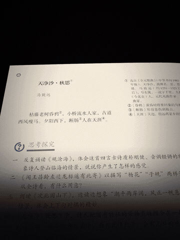
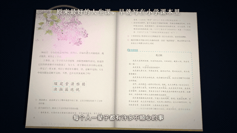
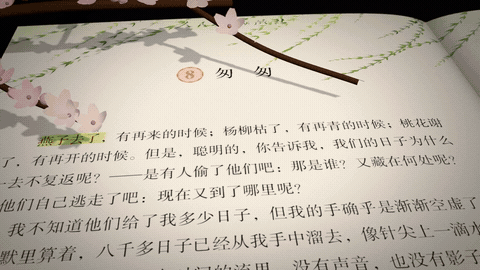

# textbook-imagery-video

书 · 意象 · 金句：制作好书分享的唯美短视频。真实书页、立体意象、原文金句、沉稳旁白和行书艺术字幕，默认输出 1080×1440 的 3:4 竖版成片，并附 3:4 / 4:3 封面及抖音文案。

## 输出效果参考

已收录三条实际成片，点击动图可打开完整 MP4（含旁白和配乐）。[查看全部示例与技术信息](examples/README.md)。

### 《天净沙·秋思》｜当前竖版示例

1080×1440 · 3:4 · 26.4 秒

[打开完整 MP4](examples/videos/tian-jing-sha-qiu-si-3x4.mp4)

### 早期横版示例

| 《丁香结》｜宗璞 | 《匆匆》｜朱自清 |
| --- | --- |
|  |  |
| 1920×1080 · 22.2 秒 · [完整 MP4](examples/videos/ding-xiang-jie-16x9.mp4) | 1920×1080 · 45.4 秒 · [完整 MP4](examples/videos/cong-cong-16x9.mp4) |

这两条是早期横版成片，当前 skill 默认输出仍为 3:4 竖版。动图是静音节选，完整声音在 MP4 中。

## 使用

将整个仓库复制到 `~/.claude/skills/textbook-imagery-video/`，然后说：

> 用 textbook-imagery-video 分享《某本书》。

完整流程见 [SKILL.md](SKILL.md)，场景技术说明见 [references/scene.md](references/scene.md)。

## 内容

- `assets/template/`：《天净沙·秋思》模板工程及图片、字体素材。
- `assets/examples/congcong/`：《匆匆》早期工程代码（不含对应素材）。
- `scripts/fetch_textbook.py`：课本预览页下载脚本。

## 运行条件

需要 Node.js、Python 3、Chrome/Chromium、FFmpeg；图片处理使用 Pillow、NumPy、SciPy。模板内运行 `npm install` 安装 JavaScript 依赖。旁白需要自己的 ElevenLabs API key，通过 `ELEVENLABS_API_KEY` 环境变量提供。生图、语音校验和本机配乐路径详见 SKILL.md。部分脚本含作者本机路径，换设备时需调整。

仓库未包含 API 密钥或单独的旁白、配乐源文件；示例成片保留原有旁白与配乐，仅用于效果展示。书页、书中文字及第三方素材的权利归相应权利人；字体许可见素材目录内的 OFL 文件。本仓库未额外授予第三方内容的使用许可。
