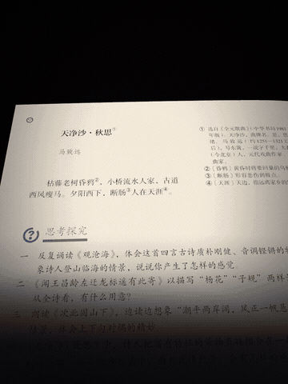
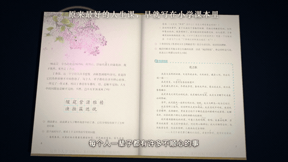
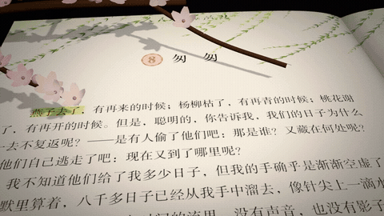

# 输出效果参考

以下三条均为 `textbook-imagery-video` 制作过的实际成片，保留原始 MP4 与原有声音。动图是从成片中截取的 6 秒静音片段；完整效果与旁白、配乐请打开对应 MP4。

《天净沙·秋思》展示当前默认的 3:4 竖版形式；《丁香结》《匆匆》保留早期横版效果，供观察书页、意象和金句的表现，不代表当前默认画幅。

## 《天净沙·秋思》｜马致远

当前 3:4 竖版示例 · 1080×1440 · 26.4 秒

[打开完整 MP4（含声音）](videos/tian-jing-sha-qiu-si-3x4.mp4)

## 《丁香结》｜宗璞

早期 16:9 横版示例（v6，情感女声） · 1920×1080 · 22.2 秒

[打开完整 MP4（含声音）](videos/ding-xiang-jie-16x9.mp4)

## 《匆匆》｜朱自清

早期 16:9 横版示例（v3） · 1920×1080 · 45.4 秒

[打开完整 MP4（含声音）](videos/cong-cong-16x9.mp4)

书页、原文和配乐等第三方内容的权利归相应权利人；示例用于展示制作效果。技术信息与校验值见 [manifest.json](manifest.json)。
